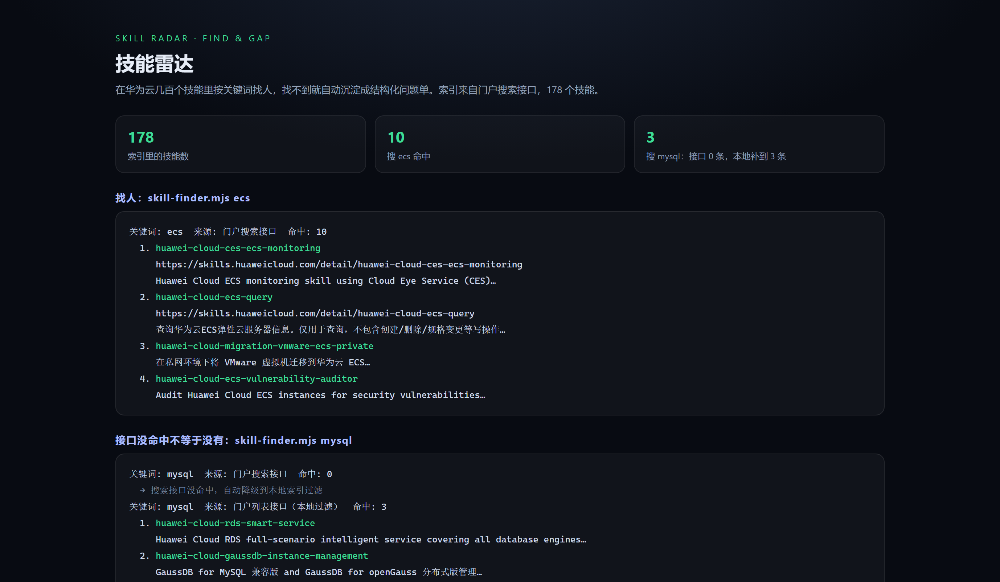

# skill-radar

用本地零依赖 Node 脚本，等价复现「让 AI 帮你找到所需的华为云技能」实践：检索华为云 Skills 市场，找到能做事的技能；当能力缺失时，产出一份结构化问题单。

## 1. 官方路径与本工具的关系

官方做法是在 **AI DevSpace** 中安装两个技能：

| 官方技能 | 作用 |
| --- | --- |
| `huawei-cloud-find-skills` | 按自然语言搜索、浏览、发现并安装华为云 Agent Skill，回答“有没有管理 ECS/OBS/RDS 的 skill”。 |
| `huawei-cloud-vod-collector` | 采集开发者在使用华为云时的不良体验与能力缺口（Voice of Developer），沉淀为高价值需求/问题反馈。 |

本仓库的 `skill-finder.mjs` 是这两个能力的**本地等价实现**，用于没有云端 AI Shell / AI DevSpace 的环境：

- 对应 `huawei-cloud-find-skills`：直接检索技能索引，输出技能名、详情链接和一句话简介。
- 对应 `huawei-cloud-vod-collector`：`--gap` 把“搜不到”转化为带复现步骤、期望能力、优先级的问题单。

它不替代官方技能，也不改变官方市场的任何数据，只读取公开页面与公开接口。

## 2. 快速开始

要求 Node.js 18+（使用内置 `fetch`，无任何 npm 依赖）。

```bash
node skill-finder.mjs ecs
node skill-finder.mjs obs mysql bss rds --limit 5
node skill-finder.mjs cce-cost --gap --priority P1
node skill-finder.mjs ecs --json
```

常用参数：

| 参数 | 说明 |
| --- | --- |
| `--limit <n>` | 每个关键词最多展示 n 条，默认 10 |
| `--gap` | 无结果时在 `gaps/` 生成 Markdown 问题单 |
| `--type <type>` | `能力缺口`（默认）或 `体验问题` |
| `--expect <text>` | 自定义“期望能力” |
| `--workaround <text>` | 自定义“当前替代方案” |
| `--priority <p>` | `P0` / `P1` / `P2`，默认 `P2` |
| `--reporter <name>` | 提交人，默认读取 `git config user.name` |
| `--out <file>` | 指定问题单路径（单关键词时生效） |
| `--json` | 以 JSON 输出，便于二次处理 |
| `--refresh` / `--no-cache` | 强制重新发现接口 / 不读写 24h 端点缓存 |

退出码：`0` 正常；`1` 索引获取失败；`2` 无结果且未加 `--gap`。

## 3. 数据来源与实现

入口固定为 <https://skills.huaweicloud.com>，流程如下：

1. 请求门户首页，解析 `<script type="module" src=".../assets/index-*.js">` 得到前端 bundle。
2. 从 bundle 中动态提取接口来源（`https://devdata2.huaweicloud.com`）与搜索路径 `/rest/.../hdskillservice/v1/skill/search`，缓存 24 小时。
3. 以 `POST {keyword, limit}` 调用搜索接口；同时用列表接口 `POST {page, size}` 读取索引总量（当前 178 个技能）。列表接口单页最多 20 条，脚本按 20 条/页分页。
4. 接口异常时依次回退：列表接口全量分页 + 本地关键词过滤 → 公开列表页 `https://skills.huaweicloud.com/skills` 的 HTML 解析（SPA 页面通常不含技能数据，仅作最后兜底）。
5. 技能详情链接按门户路由拼接：`https://skills.huaweicloud.com/detail/<skill_name>`。

一句话简介取自技能 `description`：去掉 `Triggers` 之后的触发词、取首句并截断，避免把整段提示词倒给用户。

## 4. 演示一：搜 `ecs`，找到技能

```text
$ node skill-finder.mjs ecs --limit 5

关键词: ecs  来源: 门户搜索接口  命中: 5
  1. huawei-cloud-ces-ecs-monitoring
     https://skills.huaweicloud.com/detail/huawei-cloud-ces-ecs-monitoring
     Huawei Cloud ECS monitoring skill using Cloud Eye Service (CES). Provides comprehensive monitoring and metrics…
  2. huawei-cloud-ecs-query
     https://skills.huaweicloud.com/detail/huawei-cloud-ecs-query
     查询华为云ECS弹性云服务器信息。仅用于查询，不包含创建/删除/规格变更等写操作。当用户需要查看华为云ECS实例列表、实例详情、实例状态时使用。支持AK/SK和Token两种认证方式，支持表格和JSON两种输出格式，支持…
  3. huawei-cloud-migration-vmware-ecs-private
     https://skills.huaweicloud.com/detail/huawei-cloud-migration-vmware-ecs-private
     在私网环境下将 VMware 虚拟机迁移到华为云 ECS，适用于源端和目的端位于不同网络段、通过 VPN 打通的场景。无公网 IP/EIP、VPN 打通、代理 ECS 部署 squid+GOST+rsync 实现代理/转…
  4. huawei-cloud-ecs-vulnerability-auditor
     https://skills.huaweicloud.com/detail/huawei-cloud-ecs-vulnerability-auditor
     Audit Huawei Cloud ECS instances for security vulnerabilities across host OS packages, running services, appli…
  5. huawei-cloud-ecs-dsh-deploy
     https://skills.huaweicloud.com/detail/huawei-cloud-ecs-dsh-deploy
     Huawei Cloud Flexus X Instance Deployment - DeepSeek Harness (dsh). ⚠️ Deployment involves actual charges, mus…
```

索引内 `ecs` 相关技能共 **12 个**（含查询、监控、告警、生命周期、漏洞审计、迁移、一键部署等），上表按接口返回顺序展示前 5 个。结论：ECS 能力覆盖充分，可直接按名称定位并安装对应技能。

## 5. 演示二：搜 `cce-cost`，生成问题单

```text
$ node skill-finder.mjs cce-cost --gap --priority P1 --out gaps/gap-cce-cost.md

[gap] 已生成问题单: gaps\gap-cce-cost.md

关键词: cce-cost  来源: 门户搜索接口  命中: 0
  未找到匹配的技能。
```

（完整命令还用 `--expect` / `--workaround` 注入了 CCE 成本优化的期望能力与临时替代方案，见问题单正文。）

生成的问题单：[gaps/gap-cce-cost.md](gaps/gap-cce-cost.md)，核心字段如下：

| 字段 | 内容 |
| --- | --- |
| 标题 | `[能力缺口] 未找到与「cce-cost」相关的华为云技能` |
| 问题类型 | 能力缺口 |
| 涉及技能 | 9 个 CCE 相关技能，均未覆盖成本优化 |
| 期望能力 | 统计节点/工作负载资源用量与计费模式，识别闲置与低利用率资源，给出规格调整、弹性伸缩、计费组合建议 |
| 当前替代方案 | 人工在成本中心核对账单，结合 AOM/CES 指标分析利用率 |
| 复现步骤 | 门户搜索 `cce-cost` → 0 条；本地 `node skill-finder.mjs cce-cost` → 0 条 |
| 优先级 | P1（高） |
| 提交人 | `szh20070110-dotcom`（取自 git config） |

### 关于 `cce` 的说明

任务原始预设是“搜 `cce` 找不到”。**2026-11-03 实测并非如此**：`cce` 能命中 9 个官方技能（集群管理、日志分析、指标分析、告警关联、环境评估、迁移、混沌演练、Kubernetes 事件分析等）。如果照预设生成“cce 缺失”问题单，会与市场事实不符。

因此演示二改用真实返回 0 条的 `cce-cost`：CCE 本身已被覆盖，缺口在**成本分析与优化**这一细分能力。问题单的“涉及技能”一栏会回查 `cce` 族技能，列出已有 9 个作为对照，证明不是没查、而是确实缺这一类。

## 6. 问题单字段

`--gap` 输出 YAML frontmatter + 固定分节，字段齐全且可被工单系统解析：

```yaml
title: "[能力缺口] 未找到与「cce-cost」相关的华为云技能"
type: capability-gap
keyword: "cce-cost"
priority: P1
reporter: "szh20070110-dotcom"
created_at: "2026-11-03 03:03:21"
index_source: "https://devdata2.huaweicloud.com/.../v1/skill/search"
index_total: 178
```

正文包含：标题、问题类型、涉及技能、期望能力、当前替代方案、复现步骤、优先级、提交人，以及检索时间、索引总量、端点与 bundle 版本等补充信息，便于复现与定级。

## 7. 目录结构

```text
.
├── skill-finder.mjs          # 零依赖检索与问题单生成脚本
├── gaps/
│   └── gap-cce-cost.md       # 演示二生成的问题单
├── README.md
└── .skill-finder-cache.json  # 运行时端点缓存（24h，已被 git 忽略）
```

## 8. 已知限制

- 门户是 SPA，接口路径由 bundle 动态发现；官方调整前端版本后可能需要 `--refresh`，脚本已内置默认端点与三级回退。
- 搜索接口是门户自用接口，无公开 SLA；脚本只读、不登录、不携带 AK/SK，也不执行任何安装或云资源写操作。
- `--gap` 的“能力缺口”判定以索引检索结果为准，不代表云端绝对没有该能力；正式提单前建议再用官方 `huawei-cloud-find-skills` 复核一次。
- 一句话简介由 `description` 截取，可能丢失触发词细节，安装前请打开详情链接确认。

## 三级检索

搜索走三层，任何一层命中就返回：

1. 门户搜索接口（快、准，但只认接口分词，mysql / 中文关键词常常 0 命中）；
2. 门户列表接口 + 本地过滤（拉全量索引 178 条，按名称/标签/描述做不区分大小写的子串匹配）；
3. 公开列表页（前两层都不可用时的兜底）。

所以 mysql 在接口层 0 条，会降级到本地过滤补到 3 条（RDS / GaussDB / 主备倒换）；cce-cost 三层都是 0，才是真的缺口，这时才生成问题单。
